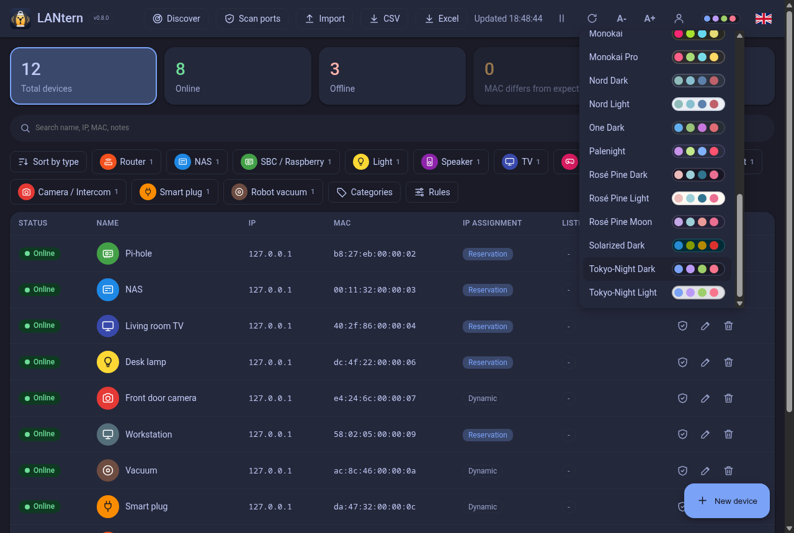

<p align="center"></p>
<h1 align="center">LANtern</h1>
<p align="center">The radar for your LAN: a small device inventory with live availability.<br>
Python standard library only. Optional login, no cloud, one SQLite file.</p>

<p align="center">
  
  
  
</p>

## What it does

- First start: LANtern discovers the devices on its own (ping sweep + ARP). The **Discover** button repeats it and adds only the new ones.
- Inventory of every device by MAC: name, IP, vendor, notes, category.
- Live status: online, offline, or "MAC differs" when an IP answers with another MAC. Auto-refresh every 30 s, with a pause button.
- IP assignment per device: dynamic, DHCP reservation, or fixed on the device.
- Port scan, per device or for all online devices. Separate from the refresh.
- Editable categories (name, icon, icon color) and filters, sort by type.
- Recognition: vendor from the MAC prefix (IEEE OUI database, updatable in one click, registry URLs editable), category from editable rules. LANtern suggests, you confirm.
- CSV and Excel export. Import from a CSV (LANtern's own export works as a backup) or an nmap XML (`nmap -sn -oX`). Known MACs are never overwritten.
- 30 themes in one menu: Classic Light and Classic Dark first (the default follows your OS), then Ayu, Catppuccin, Dracula, Nord, Tokyo Night, Kanagawa and more, each with a light variant when it has one. Font size, Italian and English (flag in the top bar).

## Run

```
python3 app.py [options]
```

Open `http://127.0.0.1:8099`. Run it on a machine inside the LAN you want to watch.

Needs Python 3. `nmap` is optional (port scan only). The OS is detected at start-up:

- **Linux**: `ping` and `ip` (iproute2).
- **Windows**: `ping` and `arp`, both built in. Run `py app.py`. **Experimental, untested on real hardware.**
- Other systems (macOS, BSD): inventory, import and export work, but status and discovery do not.

## Options

| Option | Default | Meaning |
|---|---|---|
| `-p`, `--port PORT` (or just `PORT`) | `8099` | HTTP port |
| `--host ADDRESS` | `127.0.0.1` | Listen address. Anything else needs a login user first |
| `--db FILE` (or env `LANTERN_DB`) | `devices.db` next to `app.py` | SQLite file |
| `--subnet CIDR` | detected | Subnet to sweep, repeatable, `/22` at most. Use it when detection picks the wrong network (VPN, several adapters) |
| `--no-discover` | off | Skip the discovery on first start (the Discover button still works) |
| `--set-password USER` | | Create or replace the login user, then exit |
| `--disable-login` | | Remove the login user, then exit |
| `--version` | | Print the version |
| `seed.local.json` | none | Optional automatic import on first start, JSON: `[[name, ip, mac, vendor, type, notes, reserved], ...]`, `reserved` = 0 dynamic, 1 reservation, 2 fixed |

The database starts empty and fills itself with a discovery on first start. `seed.local.json` is only needed to import data you already have.

## Login

Off by default. Turn it on from the account button in the top bar, or from the shell:

```
python3 app.py --set-password max     # asks for the password, then exits
python3 app.py --disable-login        # lost password: remove the user (needs access to the db file)
```

- One user, stored in the `users` table of the database. The password is hashed with scrypt and a random salt, never stored in clear.
- Session cookie: `HttpOnly`, `SameSite=Strict`, 12 hours, kept in memory (a restart signs everybody out). After 5 wrong passwords the client waits one minute.
- With `--host` set to anything other than this machine, LANtern refuses to start until a user exists.
- The cookie has no `Secure` flag because LANtern speaks plain HTTP. To use it across the network, put it behind a reverse proxy with HTTPS.

## Security

LANtern listens on `127.0.0.1` by default. It can scan your network, so do not expose it to the internet. On loopback it also rejects requests whose `Host` is not `localhost` (DNS rebinding), and cross-site POSTs.

## Credits

Theme colors come from the built-in palettes of [Noctalia](https://github.com/noctalia-dev/noctalia) (MIT), as collected in [NaviradioManagerPlus](https://github.com/nightwatch75/NaviradioManagerPlus).

## License

MIT
